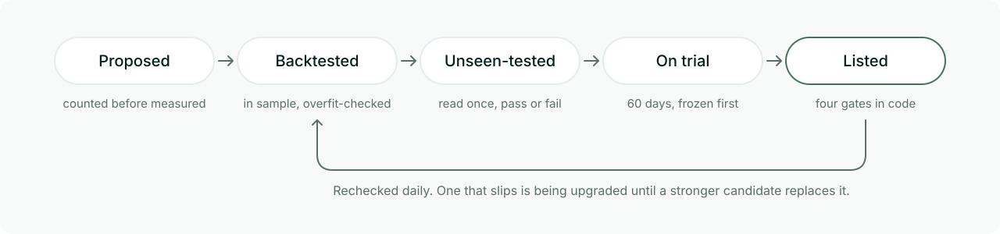

<picture>
  <source media="(prefers-color-scheme: dark)" srcset="assets/readme/hero-dark.svg">
  
</picture>

# Archon

**The first self-improving trading desk on Hyperliquid.**

Agents propose new strategies every day, and the desk tests every candidate they write. Each
candidate is backtested, tested once on prices its search never saw, then frozen into a
60-day trial on live prices. It's listed only if it beats holding the same markets,
net of fees and funding, and passes every gate. Nobody signs off.

Three things make that hard to fake. Every candidate is counted before it's measured, and each
winner's luck statistics are charged against every candidate ever counted. The gates are code,
so moving one is a commit, not a setting, and decisions made before the move stay in the record.
And every proposal, unseen test, trial and decision is a record in a SHA-256 hash chain that the
desk verifies before every write.

This repository is that method and its proof: the research contract as small, dependency-free,
tested Python, the methodology behind it, and evidence from the desk's record that you can check
from a fresh clone.

## Five stages

<picture>
  <source media="(prefers-color-scheme: dark)" srcset="assets/readme/stages-dark.svg">
  
</picture>

1. **Proposed.** A strategy is a short module with a one-sentence economic reason and the
   candidates it will try. Each candidate joins the global trial counter before it's measured,
   and the counter only goes up.
2. **Backtested.** The search reads only prices before 2026-03-01. Candidates rank across folds
   by their median edge over holding, near-duplicates are dropped, and a group whose PBO is
   above 0.5 proposes nothing.
3. **Unseen-tested.** The winner runs once on the prices after 2026-03-01, and the result is
   written at once, pass or fail. The registry refuses a second read.
4. **On trial.** A pass is frozen into a trial on live prices that opens at the next close. The
   window is never shortened or re-dated.
5. **Listed.** Code lists a candidate when all four gates hold: a clean unseen test, the luck
   figures, the trial, and an engine that reproduces the measured curve bar for bar.

Every listed strategy is rechecked daily. One that slips is marked as being upgraded and keeps
trading until a stronger candidate passes every gate and replaces it.

## Verify it yourself

Python 3.10 or later; the package has no dependencies.

```sh
git clone https://github.com/archonHL/archon.git && cd archon
python3 -m venv .venv && . .venv/bin/activate
pip install -e '.[test]'
python -m pytest -q
python -m archon_contract evidence     # check the shipped manifest's chain and excerpts
python -m archon_contract recompute    # recompute the listing bar and the luck gate from them
python -m archon_contract demo         # edit a record and watch verification refuse it
```

`evidence` checks the shipped registry manifest: every line is numbered in order and names the
hash of the line before it, and every excerpt in `evidence/records.json` is the record its line
lists. The record bodies stay on the desk, so this checks the manifest's own chain, not every
byte of every record; compare the head hash it prints with the one the desk's public feed serves.

`recompute` takes every proposal and unseen test in those excerpts and rebuilds two gates with
the code in this repository: the listing bar from the unseen test's returns, drawdowns and
costs, and the deflated Sharpe from the proposal's Sharpe, skew, kurtosis, length and benchmark. Every
result must match the record, passes and failures alike.

## The contract

Search enough candidates and some will look brilliant on history by chance. Each line of the
contract closes one way of fooling yourself, and each is code with a test.

| Line | What it stops |
|---|---|
| Trials fixed before they open | Fitting a strategy to its own test. The window, the scoring code's hash and the bar are written before the trial's first bar exists. |
| Unseen prices read once | Peeking. The registry refuses a second read, and a read that scored days the search saw is labelled as such and can't list anything. |
| Deflated Sharpe ratio | A lucky winner found by trying thousands of candidates. Every candidate ever counted is charged against it. |
| White's reality check | A best candidate that only looks good because so many were tried beside it. |
| Probability of backtest overfitting | A group whose in-sample winners stop winning on the other half of the data. |
| Hash-chained registry | Rewriting history. One edited byte fails verification and stops the desk writing. |
| Gates in code | Judgement calls. No person approves a listing, and no person can force one. |
| Costs on every replay | Edges that exist only before costs. Fees and the funding each market settled are charged to the strategy and to the holding it's compared with. |
| Replace, never empty | A catalogue that empties whenever the market turns. A strategy that slips stays listed until a stronger one passes every gate. |

## Layout

| Path | What it is |
|---|---|
| [`src/archon_contract/`](src/archon_contract/) | The contract: the chain verifier, the trial counter, the listing bar, the gates, the daily recheck, trial windows, and the reality check, deflated Sharpe and PBO |
| [`tests/`](tests/) | Its tests, including ones that plant an edge in noise and check each luck figure finds it |
| [`evidence/`](evidence/) | The registry manifest, and excerpts of every proposal and unseen test the verify commands read |
| [`docs/research-contract.md`](docs/research-contract.md) | Every line of the contract and the failure it closes |
| [`docs/methodology.md`](docs/methodology.md) | Data, costs, search, selection, the luck statistics, trials, the sweep budget |
| [`docs/promotion.md`](docs/promotion.md) | The four gates, qualification, the daily recheck |
| [`docs/registry.md`](docs/registry.md) | Record kinds, the hash chain, the trial counter, the single writer |
| [`docs/architecture.md`](docs/architecture.md) | Market data, trading and research, and how a decision reaches the catalogue |

## License

[Apache-2.0](LICENSE), code and docs alike.
