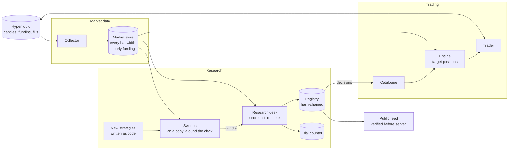

# Architecture

Archon has two halves that share one market store and one record. The trading half turns
listed strategies into positions on Hyperliquid. The research half proposes, measures, freezes,
lists and replaces those strategies. The only thing that crosses from research to trading is a
decision record in the registry.

## Market data

A collector keeps the market store current with Hyperliquid's candles and every hourly funding
settlement, from the venue's public API. The store is the single source for both halves, so the
desk measures a strategy on the same bars the engine trades it on. Every record names the sha256
of the candle set and funding it read.

## Trading

The engine is a planner. On each closed candle it reads the signals of the strategies a
subscriber follows and plans target positions; the trader places the difference. The venue is
the state: positions, equity and fills are read back from Hyperliquid on every cycle, so a
restart, crash or redeploy changes nothing it shouldn't. Each account has a
30% drawdown halt that persists across restarts and isn't tripped by deposits
or withdrawals.

The same engine runs hosted, for every hosted account, and self-hosted, on a subscriber's own
machine. Either way it trades through a trading key (Hyperliquid calls them API wallets), which
can place orders but can't move money: a withdrawal or transfer signed by one is refused. Archon
never takes custody of funds.

## Research

Three loops run at three speeds.

New strategies are written as code: a module with a one-sentence economic reason, the
candidates it will try and the signal. Whoever wrote one, it enters the contract on the same
terms, and nothing it proposes reaches an account except through the gates.

Sweeps run continuously on a copy of the record, in a bounded background container. Each round
brings its copy up to the server's record, declares and counts its candidates, measures and
selects in sample, writes the proposals and reads, and queues the result as a bundle.

The desk runs once a day on the server: it verifies the registry, adopts queued bundles, scores
trials that have closed or proved themselves, runs listing and the daily recheck, and writes the
daily report. The report opens with a few plain sentences for subscribers (how many markets a
strategy is holding, whether most markets are rising, what funding is costing) and then the full
tables.

## The record

The registry and the trial counter are written by one process on one machine, the desk on the
server. Research elsewhere arrives as bundles that append only if the chain hasn't moved since
the research began. [The registry](registry.md) covers the chain, the bundles and the public
feed.

## Why the halves are split

The desk runs as its own scheduled job rather than inside the trading worker. The worker's job
is trading, and a research run that crashes shouldn't cost an engine cycle. The desk also runs
without access to any trading key: it reads the market store and writes the record, and that's
all it can do.

## Listing reaches trading

When the desk lists a strategy, the decision record carries the catalogue entry: name, markets,
bar width and fee. The catalogue reads the latest decision per strategy, so a listing adds a
strategy subscribers can choose, an upgrade keeps one listed with its notice, and a withdrawal
takes one off the list on offer. A decision never changes what an existing account is already
trading; subscribers choose what they follow.
