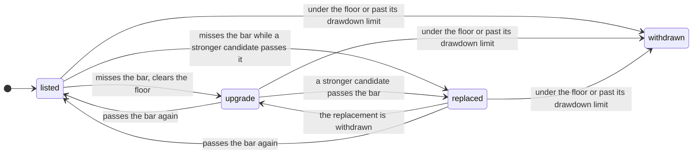

# Listing and the daily recheck

Listing is automatic. The gates are fixed in code, and the desk applies them on every daily
pass. Nobody signs off a listing, and nobody
can push one through.

## The four gates

A candidate is listed when all four hold.

| Gate | Passes when |
|---|---|
| Unseen test | Its one read of unseen prices passed the listing bar, net of fees and realised funding, and scored no day the in-sample search had read. A correction never counts. |
| Not luck | The reality check over its search has p under 0.10, and the deflated Sharpe against the global trial counter leaves under a 0.10 chance its edge is the best of that many skill-free tries. |
| Trial | Its pre-registered sequential test proved it, or a frozen window of at least 30 days closed complete, the strategy made money over it, and its worst drawdown was no more than 1.5 times its in-sample one. |
| The engine trades it | The live signal code gives the measured exposure on every stored bar of every market, and the planner, driving a simulated account on those signals, reproduces the measured curve. A market without enough history fails the gate instead of being skipped. |

The last gate is why a candidate that measures well can still wait: until the live signal can
compute it, nothing can trade it, so nothing lists it.

The luck gate needs both figures because they see different things. The reality check knows
only its own search. The deflated Sharpe is how every earlier trial is charged against the
winner.

A listing writes a `decision` record with every gate's figures and the hashes of the records it
rests on, plus the catalogue entry the platform needs to offer the strategy.

## Qualified on the evidence

A candidate whose unseen test passed doesn't have to wait out its trial if the evidence already
in hand is strong enough. It's listed as Qualified when seven further tests all hold, each fixed
before any candidate was measured on it, and the `qualify` record is written once, pass or fail:

1. **Not luck, today.** The reality check under 0.10, the deflated Sharpe against the
   trial counter as it stands today under a 0.10 chance of luck, and a PBO of at most
   0.5.
2. **Unseen markets.** On markets outside the universe it was designed on, it beats each
   market's own holding on the median.
3. **Unseen years.** The same on bars before 2024, years no search on the desk has
   read.
4. **Costs doubled.** On its unseen slice at 20 bps a side, it still makes more
   than holding with no deeper drawdown.
5. **A plateau, not a peak.** Its neighbours one step away keep at least 50%
   of its edge on the median.
6. **The edge is there.** A block bootstrap of its unseen daily excess gives a probability of at
   least 0.9 that the edge is above zero.
7. **Named crises.** In each of 4 named market crises it never reaches the
   30% halt and falls no further than holding the same markets.

Its trial keeps running. A Qualified strategy whose trial fails is withdrawn for good.

## The daily recheck

Every listed strategy is rechecked every day: its walk-forward since the split is measured again
on every bar against the listing bar, and its worst drawdown since listing is checked against its
in-sample one. A drawdown more than 2 times its in-sample one withdraws
it. A strategy is rechecked on its whole universe or not at all: if a listed market has no stored
bars, or its bars stop early, the recheck writes nothing and says why.

| Outcome | When |
|---|---|
| keep | The walk-forward passes the bar and the drawdown is inside its limit. |
| upgrade | It misses the bar but clears the floor, inside its drawdown limit, and no stronger replacement is listed. It stays listed and trading. |
| replaced | As above, but a listed candidate that passes the bar today takes its place. |
| withdraw | It broke its drawdown limit, or missed the floor too. |

## Replace, never empty

A catalogue that empties itself whenever the market turns leaves subscribers with nothing to
trade while the desk searches. So a strategy that only misses the bar is marked as being
upgraded and stays on offer, with one plain sentence saying why, until a stronger candidate
passes every gate and replaces it. If its walk-forward passes the bar again, it's restored.

The latest decision per strategy is its state. A recheck that leaves the state unchanged writes
nothing, so the registry holds only changes of state.

A withdrawal for a breach or a missed floor is final. A strategy withdrawn that way is never
listed again; a re-test is a new proposal, with new trials on the counter.

The floor came after the desk's first rechecks, which judged the strategies it started with
against the bar alone and withdrew those that missed it. Those withdrawals were never judged
against the floor, so they aren't final: the first recheck with the floor put the ones that
clear it back on offer as being upgraded. The registry keeps both decisions, the later one
naming the record it supersedes.

[`review.py`](../src/archon_contract/review.py) has the state machine, with tests for each
transition, including a withdrawal written before the floor existed.
