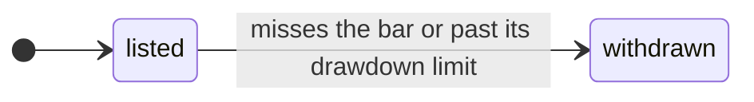

# Listing and the daily recheck

Listing is automatic. The gates are fixed in code, and the desk applies them on every daily
pass. Nobody signs off a listing, and nobody
can push one through.

## The four gates

A Proven candidate is listed when all four hold. The separate Qualified route below can
list earlier if its additional evidence gates pass and its trial has not failed.

| Gate | Passes when |
|---|---|
| Unseen test | Its one read of unseen prices passed the listing bar, net of fees and realised funding, and scored no day the in-sample search had read. A correction never counts. |
| Not luck | The reality check over its search has p under 0.10, and the deflated Sharpe against the global trial counter leaves under a 0.10 chance its edge is the best of that many skill-free tries. |
| Trial | The code accepts its pre-registered sequential result, or a frozen window of at least 30 days closed complete, the strategy made money over it, and its worst drawdown was no more than 1.5 times its in-sample one. |
| The engine trades it | The live signal code gives the measured exposure on every stored bar of every market, and the planner, driving a simulated account on those signals, reproduces the measured curve. A market without enough history fails the gate instead of being skipped. |

New sweeps use fixed forward windows; the [methodology](methodology.md#historical-read-then-trial)
describes the nominal confidence levels and calibration status of legacy sequential results.

The engine gate compares the planner with the construction actually measured: fixed
equal-weight shares or positions sized at entry. This allocation comparison runs without
fees, funding or halts. Executed-order parity requires reconciliation with venue fills.

The last gate is why a candidate that measures well can still wait: until the live signal can
compute it, nothing can trade it, so nothing lists it.

The luck gate needs both figures because they see different things. The reality check knows
only its own search. The deflated Sharpe is how every earlier trial is charged against the
winner.

A listing writes a `decision` record with every gate's figures and the hashes of the records it
rests on, plus the catalogue entry the platform needs to offer the strategy.

## Qualified on the evidence

A candidate whose unseen test passed doesn't have to wait out its trial if the evidence already
in hand is strong enough. It's listed as Qualified when seven further tests all hold, each fixed
before any candidate was measured on it, and the `qualify` record is written once, pass or fail:

1. **Not luck, today.** The reality check under 0.10, the deflated Sharpe against the
   trial counter as it stands today under a 0.10 chance of luck, and a PBO of at most
   0.5.
2. **Unseen markets.** On markets outside the universe it was designed on, it beats each
   market's own holding on the median.
3. **Unseen years.** The same on bars before 2024, years no search on the desk has
   read.
4. **Costs doubled.** On its unseen slice at 20 bps a side, it still makes more
   than holding with no deeper drawdown.
5. **A plateau, not a peak.** Its neighbours one step away keep at least 50%
   of its edge on the median.
6. **The edge is there.** A block bootstrap of its unseen daily excess gives a probability of at
   least 0.9 that the edge is above zero.
7. **Named crises.** In each of 4 named market crises it falls no further than holding
   the same markets. A candidate whose record says it was measured with the halt, as every
   one proposed before 31 October 2026 was, must also never reach the 30% halt
   there.

Qualification verifies value-bound receipts and each measured leg's exposure references
against the reviewed ledger. Establishing independence also requires review of archive
provenance and broader exposure history. Each candidate needs applicable verified evidence;
its trial continues while that evidence is assessed. A Qualified strategy whose trial
fails is withdrawn for good.

## The daily recheck

Every listed strategy is rechecked every day: its walk-forward since the split is measured again
on every bar against the listing bar, and its worst drawdown since listing is checked against its
in-sample one. A drawdown more than 2 times its in-sample one withdraws
it. A strategy is rechecked on its whole universe or not at all: if a listed market has no stored
bars, or its bars stop early, the recheck writes nothing and says why.

| Outcome | When |
|---|---|
| keep | The walk-forward passes the bar and the drawdown is inside its limit. |
| withdraw | It misses the bar, or it broke its drawdown limit. |

## Listed only while it beats holding

A strategy is listed only while it beats holding the same markets on both return and worst fall.
One that stops is withdrawn the same day, and a withdrawal is final: a re-test is a new proposal,
with new trials on the counter. The catalogue may be empty while the desk searches. A subscriber
already running a withdrawn strategy keeps it until they switch; nobody new can pick it.

The latest decision per strategy is its state. A recheck that keeps a strategy writes nothing, so
the registry holds only changes of state.

A never-empty policy, withdrawn by the owner in November 2026, kept three strategies on offer that
missed the bar but cleared a weaker floor (return or drawdown ahead of holding). Its `upgrade`
records stay in the registry; a strategy whose latest decision is one is rechecked like a listed
one, on the bar alone.

[`review.py`](../src/archon_contract/review.py) has the state machine, with tests for each
transition, including an `upgrade` record from the withdrawn policy.
